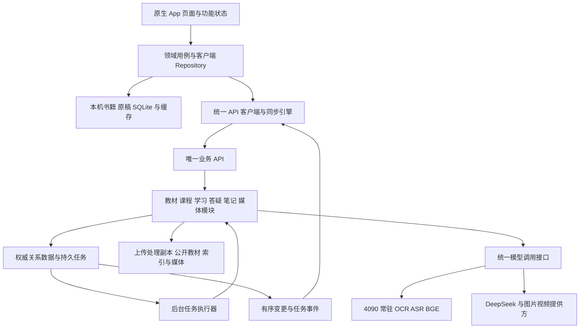

# CloudPath 新架构设计提案

状态：设计提案。适用范围：原生 iPhone 和 iPad App、局域网或 VPN 下的单用户首版，随后逐步扩展。初始问题依据为主分支 `3793dcd` 及已核实的部署记录，随后按用户要求补充数据归属和去演示数据实现。下方目标结构仍需分阶段迁移；本次接通真实入口不等于已经完成整个架构重构。

CloudPath 帮助用户把自己的教材变成适合当前目标和知识起点的个人课程，并通过阅读、练习和复习持续调整后续教学。新架构围绕这条学习流程组织：一个原生客户端、一个负责共享数据与模型任务的业务后端、可恢复的后台任务、统一管理的常驻 GPU 能力和云端模型调用。

## 产品主线

完整学习闭环为：

**导入教材 → 确认目标与目录 → 简短能力诊断 → 获得教学单元 → 阅读和练习 → 形成学习证据 → 安排复习与下一步。**

用户始终可以从生成内容回到原书。图片、视频、问答和笔记围绕当前资料与学习单元提供帮助；图片或视频生成失败，不影响原文阅读、文字课程和练习。

用户声明的偏好、真实作答形成的能力证据，以及尚无证据的未知状态分别保存。修改每日时间会改变任务安排；一次阅读完成或点击“记住了”不能直接等同于已经掌握。

首版优先闭合一个用户的完整学习流程。完整好友私信、内容社区运营、积分交易和跨书通用能力画像保留扩展边界，暂不进入核心链路。

## 数据放在哪里

| 内容 | 归属与实际行为 |
| --- | --- |
| 社区目录、公开课程、分享与评论 | 后端管理并返回；只展示明确发布的真实条目，不在手机内硬编码社区书单、人数、评论或虚构热度 |
| 我的书及原始文件 | 本机文件和本机书籍清单为原件依据，先落盘再请求上传；服务器处理上传副本，断网、解析失败或服务刷新不能移除本机书籍 |
| 用户文字笔记、笔迹、录音 | 本机先保存用户原稿；用户触发 AI 时才发送所需副本，转写和整理结果作为派生内容，由用户确认采用 |
| OCR、RAG 索引、教学内容、生成媒体 | 后端执行并记录真实任务与来源；App 缓存实际结果，明确区分原文已就绪、教学尚未生成和模型服务不可用 |
| 课程安排与学习记录 | 本机保存未发送操作与离线阅读位置；服务器确认在线课程和学习事件，不能用默认成绩或预填错题替代用户行为 |

社区“获取访问权”与“已下载到本机”是两种状态。只有文件下载并校验完成，才可标记本机原件可用；未获取的社区书不会自动进入个人书架。用户主动导入本地书，也不自动发布到社区。

本次代码已关闭普通启动的示例书籍、示例笔记、预填错题、虚拟积分及社区本地补全，移除后端按书单排序自动分书和自动发布。语音、手写整理及图片视频入口改用真实 Studio 任务，导出入口实际写 PDF。服务失败保留真实原稿并显示错误。历史未编辑的客户端预览记录归档后移出可见列表，已导入原件与修改内容保留。固定输入仅留在明确的 Debug 测试入口，Release 忽略 fixture 参数。

这些是当前分支的源代码变更，仍需 Xcode/iOS SDK 构建、签名和真机验收；不能当作 Windows、4090 或已安装 App 都已同步升级。

## 初始版本的混乱来源

| 问题 | 当前证据 | 新设计的处理 |
| --- | --- | --- |
| 同名对象含义不同 | 前端 [Course](https://github.com/AdjacentGarden/LLM_Study_App/blob/3793dcdecf6db7b7053745b46a9b4a0688315fd4/frontend/Core/Models.swift#L263) 是多资料工作区；[CloudStore](https://github.com/AdjacentGarden/LLM_Study_App/blob/3793dcdecf6db7b7053745b46a9b4a0688315fd4/frontend/Core/CloudStore.swift#L461) 中生成的 course 又是一章教学内容 | 统一课程、课程资料、教材版本、教学单元和计划任务的含义 |
| 教学内容有多套表达 | [personalization/models.py](https://github.com/AdjacentGarden/LLM_Study_App/blob/3793dcdecf6db7b7053745b46a9b4a0688315fd4/backend/src/adaptive_learning/personalization/models.py#L52) 同时存在 LearningUnit、StudyUnit 和平铺章节字段；[CloudMapping](https://github.com/AdjacentGarden/LLM_Study_App/blob/3793dcdecf6db7b7053745b46a9b4a0688315fd4/frontend/Core/CloudMapping.swift#L70) 再映射为旧 Lesson | 一个教学单元内容模型，计划只引用单元 |
| 前端承担服务端编排 | [CloudStore](https://github.com/AdjacentGarden/LLM_Study_App/blob/3793dcdecf6db7b7053745b46a9b4a0688315fd4/frontend/Core/CloudStore.swift#L243) 轮询 OCR、同步准备索引，再进入诊断和生成 | 前端提交意图并观察任务，后端持有完整工作流 |
| 同一业务有两条执行路径 | [native prepare](https://github.com/AdjacentGarden/LLM_Study_App/blob/3793dcdecf6db7b7053745b46a9b4a0688315fd4/backend/src/adaptive_learning/api/native_routes.py#L657) 同步执行；[通用 prepare](https://github.com/AdjacentGarden/LLM_Study_App/blob/3793dcdecf6db7b7053745b46a9b4a0688315fd4/backend/src/adaptive_learning/api/app.py#L620) 使用后台队列 | 两个兼容入口调用同一个 PrepareBook 用例 |
| 入口和执行器耦合 | [app.py](https://github.com/AdjacentGarden/LLM_Study_App/blob/3793dcdecf6db7b7053745b46a9b4a0688315fd4/backend/src/adaptive_learning/api/app.py#L136) 导入时创建仓库和模型客户端，[lifespan](https://github.com/AdjacentGarden/LLM_Study_App/blob/3793dcdecf6db7b7053745b46a9b4a0688315fd4/backend/src/adaptive_learning/api/app.py#L244) 启动多种工作线程，[native_router](https://github.com/AdjacentGarden/LLM_Study_App/blob/3793dcdecf6db7b7053745b46a9b4a0688315fd4/backend/src/adaptive_learning/api/app.py#L1512) 接收整个 app 模块 | 显式依赖注入，API、执行器与 GPU 模型生命周期分开 |
| 界面文案超过接入状态 | [语音笔记](https://github.com/AdjacentGarden/LLM_Study_App/blob/3793dcdecf6db7b7053745b46a9b4a0688315fd4/frontend/Features/Notes/VoiceNote.swift#L604) 仍使用示例转写；[视频入口](https://github.com/AdjacentGarden/LLM_Study_App/blob/3793dcdecf6db7b7053745b46a9b4a0688315fd4/frontend/Features/Learning/LessonReaderView.swift#L621) 使用打包视频；[保存笔记](https://github.com/AdjacentGarden/LLM_Study_App/blob/3793dcdecf6db7b7053745b46a9b4a0688315fd4/frontend/Core/AppStore.swift#L977) 在账号模式写本机缓存 | 发布版只显示已接通的真实能力，测试替身在构建入口注入 |
| 运行实例与主分支混淆 | Windows 有原生 API 验证部署；4090 的 18126 仍为单独验收实例，其媒体提供方与 main 默认配置不同 | 一个生产业务入口，每个实例公布自己的版本、模型路由与能力状态 |

当前已有的账号缓存隔离、Keychain 凭证、不可变正文缓存、事件幂等、任务租约、原文引用和付费请求不重投应继续保留。旧架构文档包含历史目标，不能将其中所有流程当作当前已实现功能。

## 总体结构

采用模块化单体：业务按领域划分，但作为一个后端产品发布；耗时操作通过同一套持久任务机制执行。GPU 运行层独立管理模型生命周期。首版不增加 Redis、Celery、Kubernetes 或新的向量数据库。



这是职责图，不要求每个框都是独立服务或数据库。首版只有三类受管进程角色：业务 API、后台任务执行器、GPU 运行层。网关首先是一个明确的接口和统一调度组件，不另建一套公网模型平台。

### 部署职责

| 位置 | 目标职责 |
| --- | --- |
| iPhone 和 iPad | 原生界面、PDF 阅读、笔迹和录音、原件和草稿保存、缓存、同步、任务展示、媒体播放 |
| 4090 Linux | 主业务 API、任务执行、业务数据库和资料存储、常驻 GPU 模型 |
| Windows GTX1650 | 运维、验证、代码传输；当前必要时继续提供受管的模型网络出口 |
| Mac | Xcode 构建、签名和客户端开发；正常使用不依赖 Mac 在线 |
| 云端模型提供方 | 按后端明确请求完成文字、图片或视频推理，不持有本应用的课程和学习状态 |

App 只连接一个业务服务地址。目标是由 4090 承担业务主实例，Windows 上的业务验证实例不再成为另一份默认权威数据。若暂时仍需 Windows 网络出口，应将它作为独立、可监控的基础设施依赖；取得可靠出口之前不能删除。

目前已验证的 `10.249.186.201:18126` 是验收实例，8100 当时没有监听。新架构不把临时端口写入客户端业务逻辑；发布时由一个环境配置选择服务地址，内部 OCR、ASR、BGE 端口不向 App 暴露。正式入口使用稳定的 HTTPS 地址；内网 HTTP 只由明确的开发配置启用。不能通过把当前 18126 改名就宣称完成正式发布。

## 统一领域对象

| 名称 | 唯一含义与数据归属 |
| --- | --- |
| Course 课程 | 某用户为一个目标建立的学习空间，可以包含多份资料；对应当前 workspace |
| DocumentAsset 原始文件 | 本机不可变 PDF 或其他原件，以内容哈希和本机存储键标识；后端只管理上传处理副本或明确发布的共享原件，访问权单独绑定用户 |
| BookVersion 教材版本 | 某原件的一版归一化正文、原书目录与解析配置；重新 OCR 或修订正文产生新版本 |
| CourseMaterial 课程资料 | 某教材在某门个人课程中的使用实例，保存选读范围、个人目录和关联诊断 |
| SourceChapter 原书章节 | 教材自己的章节及页码范围，保留真实层级，不等同于一节教学课 |
| KnowledgePoint 知识点 | 有来源的稳定学习目标，连接讲解、题目、能力证据和复习 |
| TeachingUnit 教学单元 | 一次学习的目标、原文片段、讲解、例子、检查题和闪卡引用；一章可以有多个单元 |
| UnitVersion 单元版本 | 教学单元的不可变内容快照，绑定来源版本、偏好快照及生成配置 |
| Curriculum 课程编排 | 教学单元的组织关系与顺序，不复制教材或单元正文 |
| StudyPlan 和 PlanTask | 哪天学习或复习什么、预计多久；任务引用单元、题目或闪卡 |
| LearnerPreferences 学习偏好 | 用户声明的目标、时间、帮助方式等，可以直接编辑 |
| LearnerState 能力状态 | 根据可靠作答和复习证据形成的掌握估计、误解候选和不确定性 |
| LearningEvent 学习事件 | 带稳定 event_id 的作答、复习、完成等事实；可重传、不可重复计入 |
| Note 笔记 | 本机用户原稿及其版本；转写、整理和 AI 补充是独立派生版本，不能覆盖尚未确认的原稿 |
| MediaArtifact 辅助素材 | 某次选段或教学单元对应的图片或视频，记录来源、任务与生成配置 |
| Job 后台任务 | 执行 OCR、索引、课程生成、转写或媒体生成的工作；与学习计划任务明确区分 |

引用使用 `book_version_id + page_index + block_id + bbox/quote`；PDF 物理页和印刷页分别保存。更新 OCR 后保留旧版本及引用映射，不能让已经发布的课程突然指向另一段原文。

同一教材可以被不同课程引用，但个人目录、诊断和进度属于 CourseMaterial。服务器去重文件不会授予另一个用户访问权，也不会把个人进度写回共享教材。

`Course.diagnosis` 中的偏好问卷迁移为 `course_preferences`；真正能力诊断使用 Assessment。现有 LearningUnit、StudyUnit 与章节 Bundle 通过适配层转换为 TeachingUnit、UnitVersion 和 PlanTask，保留旧 ID 映射，不立即重建全部历史内容。

## 原生客户端结构

页面沿用当前 SwiftUI 工程与视觉资源，按用户任务拆分。AppShell 只持有登录状态、导航和当前课程上下文；功能模块持有自己的状态和生命周期。

| 模块 | 负责什么 |
| --- | --- |
| Library 和 Import | 书架、课程资料、文件保存、上传会话、准备任务和目录确认 |
| Learning | 诊断、教学单元、练习、闪卡、每日学习安排 |
| Reader | PDF 和原页、页码定位、引用跳转、选段与批注锚点 |
| Notes | 文字、笔迹、录音原件、版本、转写与整理任务 |
| Assistant | 对话、当前教材范围、答案与引用展示 |
| Media | 用户触发的生成任务、成品下载和播放 |
| Account | 会话、学习偏好、服务连接与能力状态 |

统一依赖方向为：

`View → FeatureModel → 领域用例或 Repository → 本机存储 / Remote API`。

页面不直接调用 URLSession，不决定使用哪个模型，也不拼接多个后端接口来完成 OCR 到课程的完整工作流。客户端负责交互、草稿与本地响应；评分、课程发布、能力估计和服务端任务状态由后端负责。

基础设施集中为 TypedAPIClient、TransferManager、JobClient、SyncEngine、LocalStore 和 FileCache。生产入口只使用真实存储和服务适配器；固定输入只允许由 Debug 自动化测试显式注入。发布版中服务不可用就显示真实状态，不能回退到固定转写、假生成结果或本机演示积分。

### 大文件与端侧功能

PDF 先复制到 App 管理的原件目录，再使用文件支持的 URLSession 上传任务。服务端提供上传会话、已接收偏移或分块清单、内容哈希和完成确认；上传完成后才创建教材准备任务。现有将整本 PDF 读入 Data 再拼接 multipart 的路径逐步替换。

Apple 的后台上传需要文件支持的任务；可恢复传输还需要服务端协议配合，不能只换客户端调用就宣称已经支持断点续传。参见 [URLSession 文件传输](https://developer.apple.com/videos/play/wwdc2023/10006/) 和 [后台传输限制](https://developer.apple.com/documentation/Foundation/downloading-files-in-the-background)。

端侧负责 PDF 原生文字提取、阅读、录音和笔迹。Apple Vision OCR 可用于单页拍照或选段的快速预览，再把带页码、坐标和方法标记的结果交给统一教材处理流程；是否采用应以实际教材对比结果决定。Vision 提供文字识别能力，不能据此假定与服务器整书版面解析等价，见 [Apple Vision 文字识别](https://developer.apple.com/videos/play/wwdc2019/234/)。

首版在线问答以服务器 RAG 为准；断网时支持已缓存原文查找和引用摘录，并明确标记离线模式。端侧完整向量检索作为以后可下载的离线资料包，不默认给每本书在手机和服务器各维护一套生成系统，也不依赖某地区是否可用的端侧大模型。

流式答疑的中间文本标记为生成中；引用和结果校验完成后再发布正式答案，不能把尚未核验的文字当成已验证结论。

## 后端业务模块

| 模块 | 领域责任 | 主要用例 |
| --- | --- | --- |
| Identity | 账号、会话、访问权 | 登录、验证会话、授予资料访问 |
| Materials | 原件、教材版本、OCR、目录、来源锚点 | ImportMaterial、PrepareBook、ConfirmStructure |
| Courses | 个人课程、多资料、偏好覆盖与课程编排 | CreateCourse、AttachMaterial、UpdatePreferences |
| Teaching | 能力诊断、教学策略、单元与版本 | SubmitAssessment、BuildCurriculum、GenerateUnits |
| Learning | 学习事件、评分、错题、复习与每日安排 | RecordAnswer、RecordReview、GetNextStudyTask |
| Tutoring | 资料范围、检索、带引用答疑 | AskQuestion、RetrieveEvidence |
| Notes | 原稿、版本、ASR、手写识别与整理 | SaveNote、TranscribeNote、ProposeNoteRevision |
| Media | 选段素材、生成状态与成品 | GenerateImage、GenerateVideo、GetArtifact |

API 层只做认证、参数与响应转换，调用明确的用例接口。通过 `ApplicationServices` 注入依赖，替代把整个 app 模块传进路由。核心领域不导入 FastAPI、HTTP DTO、Swift 页面名或某家模型 SDK。

统一模型接口、任务调度、文件存储、关系数据库和日志属于基础设施。模块通过用例或明确的端口协作；不能从原生路由直接操作多个领域的私有表。课程创建等短事务使用明确事务边界，模型调用不持有数据库写事务。

## 前后端通信合同

只有一个面向 App 的版本化协议：`/api/v1`。现有 `/api/native`、`/api/books`、`/api/interviews` 等入口在迁移期间保留为兼容适配器，最终调用同一组业务用例。

OpenAPI 是 HTTP 类型合同的唯一来源，生成或校验 Swift DTO；DTO 再映射为客户端领域模型。业务对象不用无类型字典传递，错误不靠中文字符串匹配。保留现有会话认证并封装到 Transport，凭证继续存入 Keychain；协议整理不同时重做整套登录方式。

| 通信类别 | 方式与恢复规则 |
| --- | --- |
| 查询与小型修改 | REST，显式版本和结构化错误 |
| 教材和录音上传 | 文件上传会话，独立于后续生成任务，按内容哈希确认 |
| OCR、准备、课程、转写、媒体 | 提交后返回 202、job_id 与查询地址，后端持续执行 |
| 任务和资源变更 | 前台保持一条经过认证的 SSE，按事件游标恢复；不可用时回退查询任务快照 |
| 问答输出 | 同一任务合同，可流式显示草稿；最终回答落库并返回可恢复的结果引用 |
| 学习事件和笔记同步 | 稳定操作 ID、批量提交、逐项回执和版本冲突处理 |
| PDF、页图和媒体下载 | 受保护的文件接口，支持范围读取和按内容版本缓存 |

202 仅表示接受处理，不表示已经成功；响应必须能定位任务状态，见 [HTTP 202 的定义](https://www.rfc-editor.org/rfc/rfc9110.html#name-202-accepted)。SSE 使用有序事件和恢复游标，参考 [Last-Event-ID](https://html.spec.whatwg.org/multipage/server-sent-events.html#the-last-event-id-header)；原生客户端需要自行实现解析和重连，不假定有浏览器 EventSource。

建议的核心入口为：

```text
GET    /api/v1/system
GET    /api/v1/courses
POST   /api/v1/courses
POST   /api/v1/uploads
PUT    /api/v1/uploads/{upload_id}/parts/{part_number}
POST   /api/v1/uploads/{upload_id}/complete
POST   /api/v1/materials/{material_id}/prepare
POST   /api/v1/courses/{course_id}/curriculum-jobs
GET    /api/v1/units/{unit_id}/versions/{version}
POST   /api/v1/learning-events/batch
PUT    /api/v1/notes/{note_id}
POST   /api/v1/notes/{note_id}/transcription-jobs
POST   /api/v1/answer-jobs
POST   /api/v1/media-jobs
GET    /api/v1/jobs/{job_id}
GET    /api/v1/operations/{client_request_id}
GET    /api/v1/events?after={cursor}
GET    /api/v1/artifacts/{artifact_id}/content
```

创建命令携带稳定 `Idempotency-Key`，同时作为 client_request_id 持久化，服务器将所有者、操作类型、规范化请求体和任务绑定。相同键与相同内容返回原结果；相同键与不同内容返回冲突。提交响应丢失、尚未拿到 job_id 时，客户端按 client_request_id 查询原回执；安全重发相同键的应用命令也只恢复原任务，不重新调用提供方。后台 URLSession 的自动恢复只用于幂等上传协议，不用于直接重投付费模型生成。

任务返回值至少包含：

```json
{
  "job_id": "job_example",
  "kind": "generate_video",
  "state": "waiting_provider",
  "stage": "provider_processing",
  "revision": 7,
  "progress": {"completed": null, "total": null, "unit": null},
  "result_ref": null,
  "error": null,
  "trace_id": "trace_example"
}
```

错误包含 `code`、面向用户的 `message`、`retry_action`、`retry_after` 和 `trace_id`。`retry_action` 区分重新连接、刷新快照、继续查询原任务，以及需要明确发起新生成；不能用一个 retryable 布尔值授权所有请求重投。

App 进入后台后不依赖 SSE 常连。服务器继续执行，回前台读取任务快照与同步游标；通知可在以后作为可选提示。页面关闭只停止订阅，取消服务器任务必须是独立命令。

## 持久任务和就绪状态

统一任务合同与调度，不把所有业务合并成一个巨大处理函数。OCR、目录、索引、课程、ASR、笔记整理和媒体各有处理器，共用持久状态、租约、心跳、幂等与错误合同。

```text
queued → running → waiting_provider / retry_wait
                   → succeeded / failed / cancelled / uncertain
```

`state` 表示执行生命周期；`stage` 表示正在做 OCR、规划、云端提交、下载、解码或发布。任务保存所有者、输入版本、依赖、请求 ID、执行尝试、租约、提供方任务 ID、策略快照和结果引用。

任务领取、结果发布与事件记录采用短事务和版本比较，过期执行器不能发布。资源成功状态与所属领域 outbox 事件在同一数据库事务持久化，随后幂等汇聚为统一事件流。保留多个 SQLite 的过渡期也遵循各领域本库原子提交，不承诺跨文件双写原子性。任务结果引用已发布资源的版本，尚未完成汇聚时可通过快照恢复。

付费提交意图先记录；请求结果不明确时进入 uncertain 并查询对账。只有取得提供方受理或完成的证据后，才能恢复同一任务；没有提供方幂等或查询依据时，不声称跨网络恰好执行一次，也不自动重发。取消使执行租约和结果发布版本失效；已经提交的云端任务只能按提供方支持的方式取消，其调用记录继续保留。

独立安排交互问答、短任务、教材批处理、外部媒体提交和媒体轮询/下载的执行容量。图片生成的长 HTTP 请求不得占住视频轮询唯一线程。轮询有超时、退避和提供方限速；可用的签名回调可以减少轮询，但服务器快照仍是恢复依据。

教材就绪拆为 `source_readable`、`text_ready`、`structure_ready`、`retrieval_ready`；课程另有 `first_unit_ready` 和 `all_units_ready`。各模块按依赖开放入口：PDF 保存后可读原文，索引完成可答疑，首个单元发布可开始学习。不能再用一个 ready 表示所有功能。

若无法估算外部模型进度，显示当前阶段、已用时间与是否可离开，不生成虚构百分比。已完成页数或单元数可以显示确定进度。

## 数据权威和离线同步

| 数据 | 权威与同步规则 |
| --- | --- |
| 教材解析、目录发布版、课程单元 | 服务器发布不可变版本；手机缓存，不在页面内改写 |
| 已保存的原始笔记、录音和笔迹 | 手机保存原稿为依据；服务器仅持有用户主动提交的处理副本及派生结果，采用结果产生本机新版本；备份和跨设备同步是单独功能，不伪称已经实现 |
| 转写、整理和 AI 补充 | 独立派生版本；展示来源和状态，用户确认后才成为采用版本 |
| 作答与闪卡反馈 | 本地事件和 outbox 同事务落盘；服务端按 event_id 去重、评分和安排复习 |
| 阅读位置和完成标记 | 按课程资料保存，使用服务端版本冲突处理；不覆盖其他资料的状态 |
| 掌握估计、FSRS 排期 | 服务端根据已接收证据计算；离线只展示已知状态和待同步反馈 |
| 编辑草稿和导航状态 | 手机持有，按账号和服务环境隔离 |
| 后台任务与调用记录 | 服务器权威，手机保存回执和最后观察版本 |

客户端 Repository 从本机读取模型提供内容，SyncEngine 负责把远端变更写入本机事务、把 outbox 发送到服务器。View 不再同时改写 workspace、source、lesson 和全局掌握集合的多份副本。

同步使用服务器变更游标和实体版本，不依赖手机时钟决定笔记内容胜负。学习事件追加合并；笔记并发编辑保留冲突版本；内容版本更新保留未发送操作。明确的会话失效仍要求重新认证，不能用离线缓存切换身份。

新部署参考配置使用 SQLite WAL 保存业务元数据、任务与 outbox，模型调用和耗时文件处理置于事务之外。现有多 SQLite 文件先由 Repository 兼容，不立即合并。已有 PostgreSQL 部署保留 PostgreSQL，不做反向迁移；以后并发扩大时沿用现有数据库适配层。PostgreSQL 的队列领取可使用短事务及 SKIP LOCKED，但不将它用于普通一致性查询，参见 [PostgreSQL SELECT](https://www.postgresql.org/docs/current/sql-select.html#SQL-FOR-UPDATE-SHARE)。

本机原 PDF、录音、笔迹与服务器处理副本、页面图、索引、生成媒体分别保存在各自受管文件目录，通过来源 ID、存储键、哈希和数据库记录关联。首版继续本机文件系统，预留对象存储接口即可；无需立即引入对象存储服务或向量数据库。索引绑定教材版本与 embedding 版本，作为可重建派生物。

## 模型和 GPU 运行层

业务调用按能力表达：OCR、Transcribe、Embed、Rerank、GenerateText、GenerateImage、GenerateVideo。提供方名称、模型 ID、网络出口和密钥留在适配层与配置中，不进入页面或领域模型。

| 能力 | 目标安排 |
| --- | --- |
| 快速 OCR | 保留当前快速 GPU 路线，模型常驻；优先提取可靠的 PDF 原生文本，扫描页进入 OCR |
| Whisper ASR | 服务器常驻，录音上传完成后生成转写任务，原音频始终保留 |
| BGE 与重排 | 移出 API 进程的模型生命周期，作为 GPU 运行层中的共享能力 |
| 教学文字与答疑 | 保留 DeepSeek 主路线；独立教学审核继续使用明确配置，不因服务故障悄悄换提供方 |
| 图片与视频 | 独立提供方适配器，实际路由由当前发布配置决定，并写入每个任务快照 |
| 媒体质量审核 | 生产配置保持 off；有效成品直接展示，保留文件校验、状态处理与防重复付费 |
| 笔记处理 | 与媒体政策分离，保持原稿保护、转写确认和整理规则 |

GPU 运行层统一入口与准入，但允许 OCR、ASR、BGE 保留各自虚拟环境和常驻进程，避免为了“统一”破坏 CUDA 和依赖兼容。API 重启或增加 HTTP 连接不应重复加载模型。

一张卡上按实测峰值设准入额度，按小批次执行 OCR 和整书 embedding，为问答检索与短录音留出响应空间。逻辑超时不代表 GPU 计算已经停止，实际执行结束前不释放占用。常驻只减少加载时间，不能消除多个任务同时计算的竞争。

模型网关统一管理提供方并发、限流、冷却、截止时间、预算、调用 ID 和网络出口。首版将实际推理调用与准入集中在一个受管调度所有者；API 只提交任务或通过内部接口获取能力，不能在多个进程中各建一套并发计数并称为统一限流。读取状态可以重试；外部生成提交按幂等能力分类。应用媒体质量审核关闭后，不自动重新添加另一层视觉评分；平台未返回成品、文件损坏和权限失败仍明确报告。

## 核心工作流与性能目标

### 导入到可学习内容

原件保存并确认上传后，PrepareBook 负责页面判型、快速 OCR、来源归一化、目录和检索准备。目录、索引和首章必要数据满足依赖后可并行执行，复用已完成的教材版本；不对已经解析的书重复 OCR。

课程用例读取学习偏好和可用的诊断证据，生成课程编排和教学单元。先发布可用单元，再继续后续单元，所有单元具备来源引用和独立版本。图片和视频不加入全书课程完成的前置依赖。

用户要求的“整书完整教学内容在 1 分钟内”保留为硬性性能目标，目前仍需验证能否达到。验收从上传开始计时，到约定范围的全书讲解、引用、练习和闪卡全部持久发布且客户端可读取为止，要求低于 60 秒；同时单列首个可学单元时间。渐进显示首课改善体验，但不能替代整书达标。

测量固定基准教材、页数、扫描比例、冷/热模型和网络条件，并列明人工确认等待时间，不从用户端到端耗时中静默扣除。按需图片、视频独立计时；若验收要求同时包含这些成品，也必须计入全流程，不能用文字完成冒充所有素材完成。未达到门槛时如实报告未达标，不凭架构选择保证速度。

### 学习到后续调整

App 提交作答或复习事件，服务器先幂等保存，再执行客观评分或语义评分；更新能力估计和复习安排。缺少证据保持未知；低置信评分允许澄清。改变偏好或新增证据只生成受影响单元的新版本，不清空历史进度或整书重算。

每日计划引用已就绪的教学单元和到期复习，后端决定顺序，App 展示并允许用户确认或调整。新版本不会在用户阅读中静默替换当前正文。

### 笔记和媒体

录音、笔迹或文字先保存，再发起转写/整理任务；结果失败也可以继续学习。媒体同样保存为独立成品，生成完成更新当前选段的附件状态，不锁住阅读器，也不自动把生成画面当作教材证据。

### 耗时追踪

每个用户操作关联 trace_id、job_id 和提供方调用 ID。记录排队、OCR、检索、提示词准备、提交确认、提供方等待、下载、文件校验、发布和客户端观察时刻；冷启动加载单列。提供方没有给出推理起止时间时，指标名称使用“提供方等待”，不能称为纯模型生成时间。

能力状态区分代码支持、客户端已接入、配置存在、运行就绪和最近验证结果。进程 health 成功不等于 OCR、DeepSeek、媒体或客户端完整流程成功。

## 代码与发布组织

保留 `frontend/` 为唯一产品原生工程；`ios/` 的兼容客户端和 `legacy/` 保持明确的归档或诊断用途，不同时承担主产品定义。建议逐步形成以下结构，先抽用例再移动文件：

```text
frontend/
  App/                 组合入口 登录 导航
  Features/            课程 学习 阅读 笔记 答疑 媒体
  Domain/              领域模型 用例 Repository 协议
  Data/                本机数据库 同步 远端适配器
  Platform/            PDFKit PencilKit 录音 Vision 适配
  DesignSystem/        现有视觉组件与资源

backend/src/adaptive_learning/
  bootstrap.py         显式装配和配置
  api/v1/              HTTP 合同 认证 响应聚合
  modules/             identity materials courses teaching learning tutoring notes media
  infrastructure/      数据库 文件 任务 模型 网络出口 追踪
  entrypoints/         api worker gpu_runtime
```

后端构建产物、数据库 schema、模型配置和客户端 API 版本分别标识。`GET /api/v1/system` 返回实际 release_id、git_sha、api_version、schema_revision、能力状态与公开模型路由摘要；不返回密钥或内网文件路径。

API、执行器和客户端共享版本化合同并声明兼容范围；执行器核验任务输入版本，服务端在声明范围内继续支持旧客户端，不要求所有端同时升级。测试、验收和正式环境的目录、数据库和端口分别配置，不能把一个临时验收服务与另一个机器上的正式客户端配置混用。

## 渐进迁移顺序

| 阶段 | 具体工作 | 完成判据 |
| --- | --- | --- |
| 先固定事实与合同 | 统一对象术语，列出每个原生按钮的数据来源；明确主实例、配置与版本信息；冻结现有 API 回归 | 原生入口无未标记的示例结果；同一课程身份可从页面追到服务器 |
| 抽取后端用例 | 用 ApplicationServices 代替全局 app 服务定位；PrepareBook 和生成用例只保留一条业务实现；旧接口继续适配 | 原有合同、访问权和幂等回归通过，不改变数据归属 |
| 统一任务与通信 | 引入 Job 合同、阶段计时、任务查询和有序事件；把准备与课程执行从 API 生命周期移出 | App 退出或 API 重启后继续同一任务；付费未知结果不重投 |
| 收拢客户端状态 | 提取 FeatureModel、Repository、JobClient 和 SyncEngine；读取本机投影，接入真正的教学单元 | 上传一本书到首课、练习、闪卡、引用、断网与重启恢复形成真实纵向闭环 |
| 接通剩余真实能力 | 笔记转写与同步、手写处理、每日计划、媒体生成改为后端任务 | 逐个入口能关联真实请求、任务和成品；模型不可用时原稿及主流程仍可用 |
| 调整 GPU 与数据布局 | 收拢 GPU 模型生命周期与准入；按备份、映射和演练结果迁移数据库布局 | 三项 GPU 能力同时运行的峰值与延迟可复现，历史引用和学习事件不丢失 |

跨 Windows 与 Linux 合并数据前，先盘点账号、课程、原件和记录，建立 source_instance_id 与旧 ID 的映射。跨库快照需要统一暂停被迁移实例的 API 写入及全部任务执行器，校验数据库与文件清单后再演练和切换；逐个 SQLite 在线备份不代表跨库一致。Windows 模型网络出口不属于应暂停的业务写入进程，继续保留。新主实例恢复后只有一个业务写入所有者，不覆盖运行中的数据库或未同步笔记。

每个阶段交付一条可运行的纵向流程，再替换下一段。新旧路径可短期并存，但同一命令只能有一个执行所有者，尤其不能向两个后端同时提交付费生成。回滚按版本和输入输出合同设计，已经新增的数据不能靠覆盖旧数据库回滚。

## 验收范围

验收以真实原生客户端为入口，至少覆盖以下情形：

- 同局域网或 VPN 下，用户安装配置后完成登录、导入 PDF、确认目录、进入教学单元、练习、闪卡、答疑引用和重启继续学习。
- 后台上传与网络中断可以恢复；用户离开页面不丢后台任务；连接中断后仍显示同一 job_id。
- 我的书先本机落盘，上传失败和服务器刷新不丢原件；社区空目录或断连不补示例书、不自动给用户分书。
- 离线笔记和学习事件先落盘，重启和重新联网不丢失、不重复评分、不串账号或课程。
- 未接入或未配置的功能显示准确状态；不使用固定转写或打包视频冒充服务器结果。
- 图片生成不会阻塞视频状态查询，生成失败不阻塞阅读和笔记；应用媒体质量审核维持关闭。
- API 重启不重载另一份 GPU 模型；冷启动、单任务和三项 GPU 并发分别记录显存峰值与延迟。
- 对约定基准教材，上传开始到全书约定教学内容持久发布且客户端可读取要求低于 60 秒；另报首课可用时间并核验全部内容覆盖。未达标如实报告，不能只测接口返回或首章就宣称整书完成。

本提案的落地起点是统一领域语言与一条真实学习流程，再逐步收拢执行和存储。已有可工作的领域算法、持久化与恢复机制通过适配迁入，避免同时重写界面、数据库、模型和通信协议。
